<p align="center">
  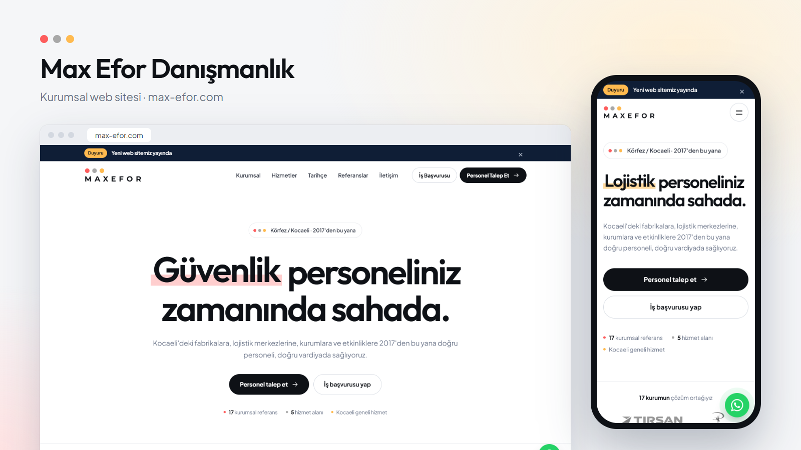
</p>

<h1 align="center">Max Efor Danışmanlık — Kurumsal Web Sitesi</h1>

<p align="center">
  Kocaeli merkezli personel temini şirketi <b>Max Efor Danışmanlık Sosyal Hizmetler Ltd. Şti.</b> için<br>
  tasarlanıp geliştirilen ve yayına alınan kurumsal web sitesi.
</p>

<p align="center">
  <a href="https://max-efor.com"><b>🌐 max-efor.com</b></a>
  &nbsp;·&nbsp; Lighthouse (mobil): Performans <b>99</b> · Erişilebilirlik <b>100</b> · En İyi Uygulamalar <b>100</b> · SEO <b>100</b>
</p>

---

## Proje hakkında

Max Efor; fabrikalara, lojistik merkezlerine, kurumlara ve etkinliklere personel sağlayan bir şirket. Sitenin iki temel görevi var:

- **Firmalar için:** Hizmetleri ve referansları tanıtmak, personel talebini birkaç tıklamayla şirket yetkilisine ulaştırmak.
- **İş arayanlar için:** Kocaeli'deki iş fırsatlarını duyurmak ve başvuruyu kolaylaştırmak.

Tasarımdan alan adı yönetimine, kurumsal e-postadan arama motoru optimizasyonuna kadar projenin tamamı uçtan uca hayata geçirildi.

## Öne çıkanlar

- **11 sayfalık kurumsal site** — Kurumsal, Hizmetler, Tarihçe, Referanslar, İletişim, Duyurular, Personel Talebi, İş Başvurusu, KVKK ve Çerez Politikası
- **3 adımlı personel talep sihirbazı** — Firma ihtiyacını adım adım toplar; hazır mesajı WhatsApp veya e-posta ile seçilen yetkiliye gönderir. Form verisi sunucuya kaydedilmez.
- **İş başvurusu formu** — Ayrı ve isteğe bağlı "aday havuzu" açık rıza seçeneğiyle
- **Duyuru ve iş ilanı sistemi** — Yönetim panelinden yayınlanan duyurular sunucu tarafında sayfaya yerleştirilir. Böylece sayfa açılırken kaymaz ve arama motorları da duyuruları görür.
- **17 kurumsal referans** — Kategoriye göre filtrelenebilen logo galerisi ve kayan logo bandı
- **KVKK uyumu** — Aydınlatma metni, çerez politikası, formlarda işaretlenmemiş onay kutuları
- **Mobil öncelikli tasarım** — 360 px'ten geniş ekranlara kadar yatay taşma olmadan
- **Erişilebilirlik** — Klavyeyle gezinme, ekran okuyucu etiketleri, "hareketi azalt" tercihine uyum

## Ekran görüntüleri

### Masaüstü

| Ana sayfa | Hizmetler |
|:---:|:---:|
| 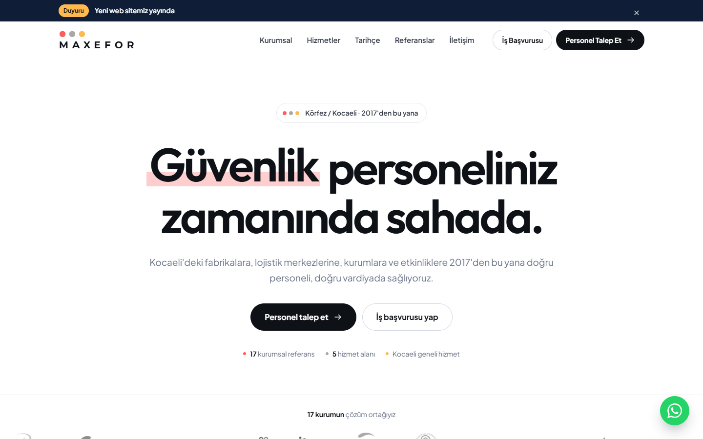 | 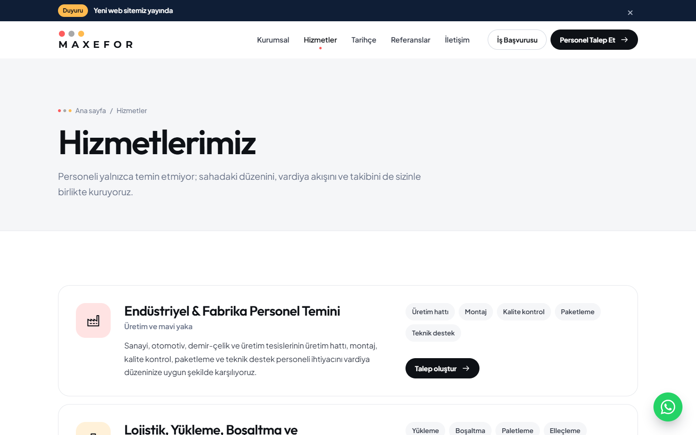 |
| **Referanslar** | **Personel talebi** |
| 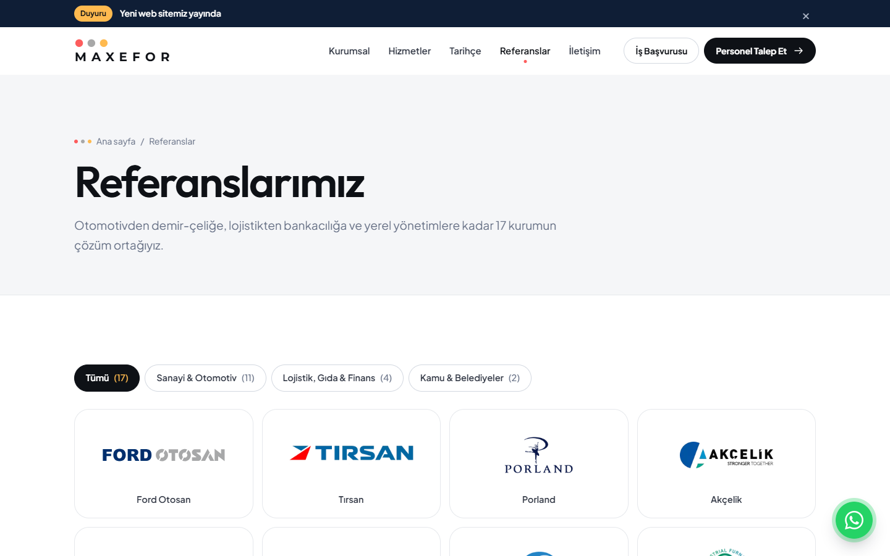 | 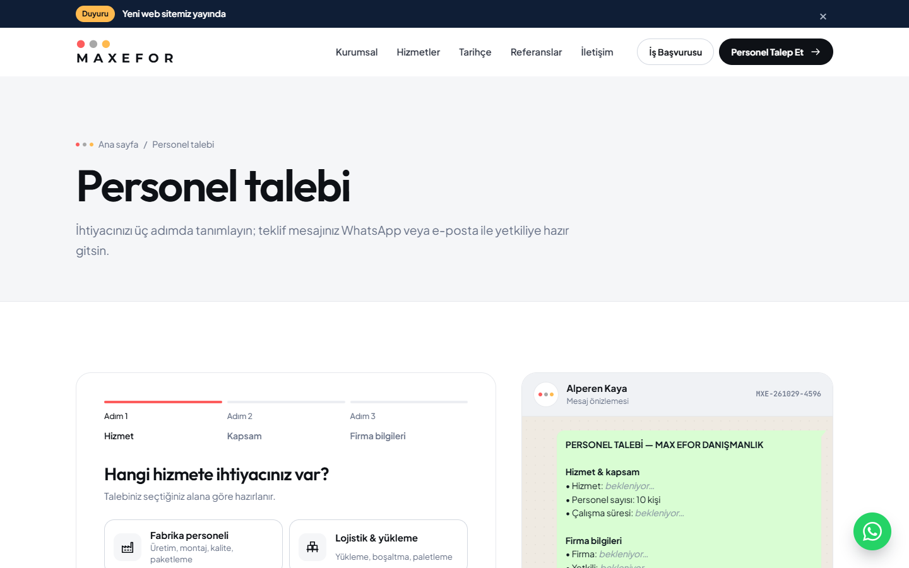 |

<p align="center">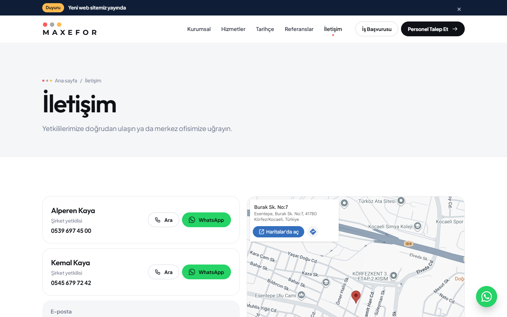<br><sub>İletişim sayfası ve konum haritası</sub></p>

### Mobil

| Ana sayfa | Menü | Personel talebi | Referanslar |
|:---:|:---:|:---:|:---:|
| 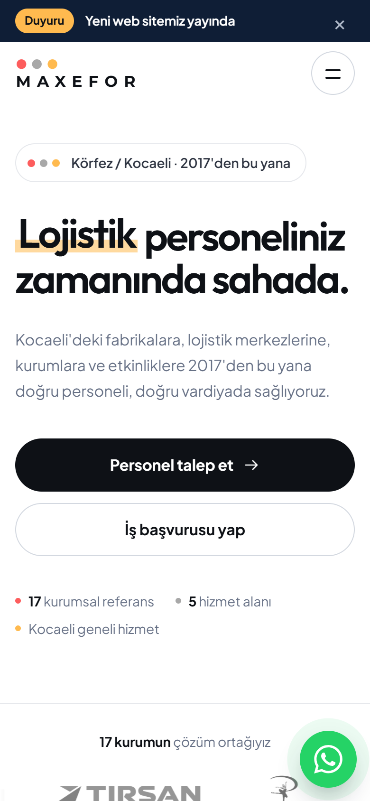 | 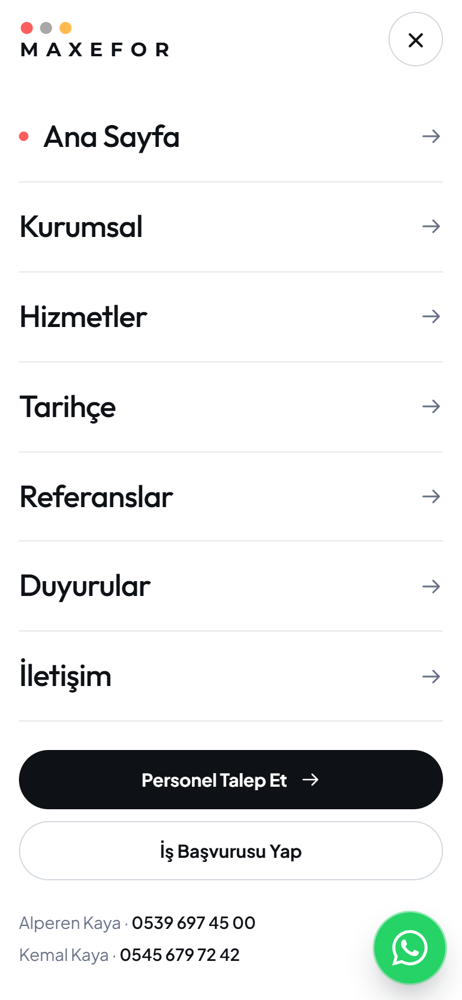 | 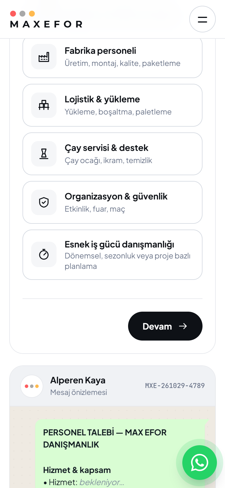 | 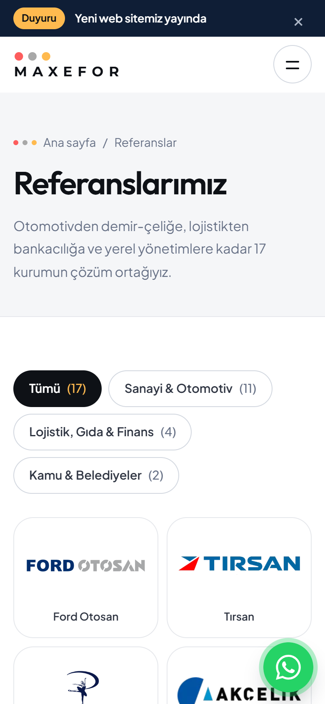 |

## Kullanılan teknolojiler

| Katman | Teknoloji |
|---|---|
| **Diller** | HTML5, CSS3, JavaScript (ES2022), Python (yardımcı araç) |
| **Ön yüz** | Çatı (framework) kullanılmadan saf HTML/CSS/JavaScript · CSS değişkenleri · View Transitions API · IntersectionObserver · Speculation Rules ile sayfa ön yükleme |
| **Barındırma** | Cloudflare Pages (küresel CDN, otomatik HTTPS) |
| **Sunucu tarafı** | Cloudflare Pages Functions (Workers çalışma ortamı) · HTMLRewriter ile sunucu tarafı içerik yerleştirme |
| **Veri** | Cloudflare Workers KV (duyurular) |
| **Güvenlik** | Cloudflare Access ile korunan yönetim paneli · güvenlik başlıkları (nosniff, Referrer-Policy, Permissions-Policy) |
| **E-posta** | Cloudflare Email Routing ile kurumsal e-posta adresi |
| **Yazı tipleri** | Outfit, Plus Jakarta Sans, JetBrains Mono — OFL lisanslı, Türkçe karakter alt kümeleriyle kendi sunucudan |
| **Derleme** | Node.js betiği: tek kaynak dosyadan her sayfa için ayrı HTML, 404 sayfası ve site haritası üretir |
| **Ölçüm ve test** | Lighthouse, PageSpeed Insights, Chrome DevTools, Playwright |

## Performans ve SEO çalışması

İlk sürüm tek sayfalık bir uygulamaydı (`#/hizmetler` gibi adresler). Google bu yapıda sitenin yalnızca ana sayfasını tanıyordu. Site çok sayfalı yapıya taşındı ve performans iyileştirmeleri yapıldı:

| Ölçüm (Lighthouse, mobil) | Önce | Sonra |
|---|:---:|:---:|
| Performans puanı | 82 | **99** |
| Largest Contentful Paint | 3,1 sn | **1,7 sn** |
| Cumulative Layout Shift | 0,20 | **0** |
| Arama motorunun tanıyabildiği sayfa | 1 | **11** |

**Yapılanlar:**

- Her sayfaya kendi adresi, başlığı, açıklaması ve kanonik bağlantısı verildi. Eski `#/` bağlantıları yeni adreslere yönlendiriliyor.
- Google Fonts yerine Türkçe karakterleri kapsayan küçük font dosyaları kendi sunucudan yükleniyor. Sayfanın ilk çizimini engelleyen istek kalmadı ve üçüncü taraflara veri aktarımı azaldı.
- Logolar gösterim boyutuna göre küçültüldü ve boyutları önceden tanımlandı; böylece sayfa kayması giderildi.
- Duyurular sunucu tarafında sayfaya yerleştiriliyor.
- Eklenenler: `sitemap.xml`, `robots.txt`, Schema.org yapılandırılmış verisi (EmploymentAgency, WebSite, BreadcrumbList), favicon seti, gerçek 404 sayfası, `llms.txt`, `www` → ana alan adı yönlendirmesi, statik dosyalar için önbellek politikası.

## Mimari

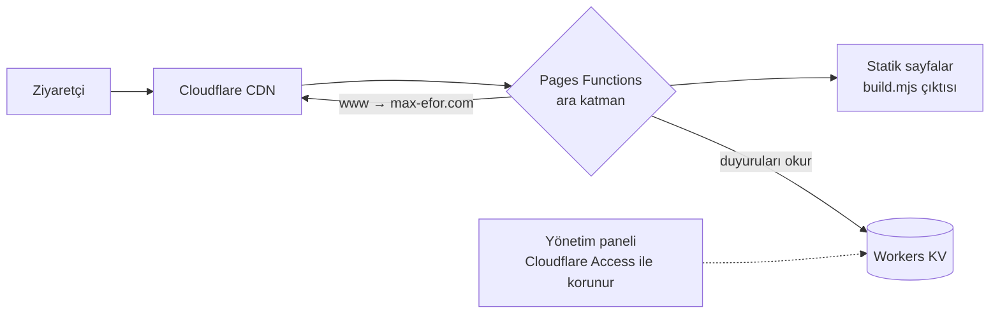

## Bu depoda neler var?

```
kaynak/
├── index.html              Sitenin tek kaynak dosyası (HTML + CSS + JavaScript)
├── build.mjs               Sayfaları, 404 sayfasını ve site haritasını üreten betik
├── functions/
│   └── _middleware.js      Duyuruları sayfaya yerleştiren, www yönlendirmesi yapan ara katman
└── tools/
    ├── subset-fonts.py     Türkçe font alt kümelerini üreten betik (fontTools)
    └── lh-summary.mjs      Lighthouse raporunu özetleyen betik
ekran-goruntuleri/          Masaüstü ve mobil ekran görüntüleri
```

> **Not:** Sitenin güvenliği için yönetim paneli, sunucu yapılandırması ve hesap bilgileri bu depoda **yer almaz**. Paylaşılan kodlar, sitenin herkese açık ön yüzüdür.

## Geliştirme süreci

Tasarım, kodlama, test ve yayına alma süreçleri yapay zekâ destekli olarak yürütüldü. Her değişiklik gerçek tarayıcıda; masaüstü ve mobil ekran boyutlarında, konsol hataları ve Lighthouse ölçümleriyle doğrulandı.

## Telif

© 2026 Max Efor Danışmanlık Sosyal Hizmetler Ltd. Şti. — Tüm hakları saklıdır.
Kodlar inceleme amacıyla paylaşılmıştır; izin alınmadan kopyalanıp kullanılamaz.
Ekran görüntülerinde yer alan referans logoları ilgili kurumların tescilli markalarıdır.
Yazı tipleri SIL Open Font License (OFL) ile lisanslıdır.

---

<p align="center">Geliştiren: <b>Alperen Kaya</b></p>
